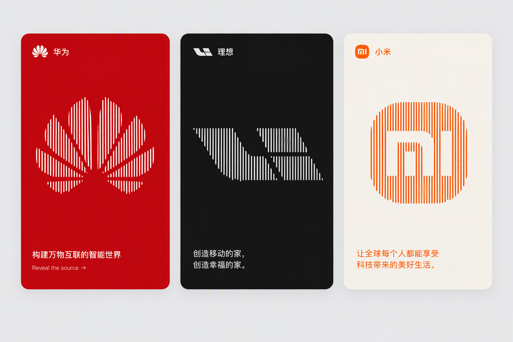
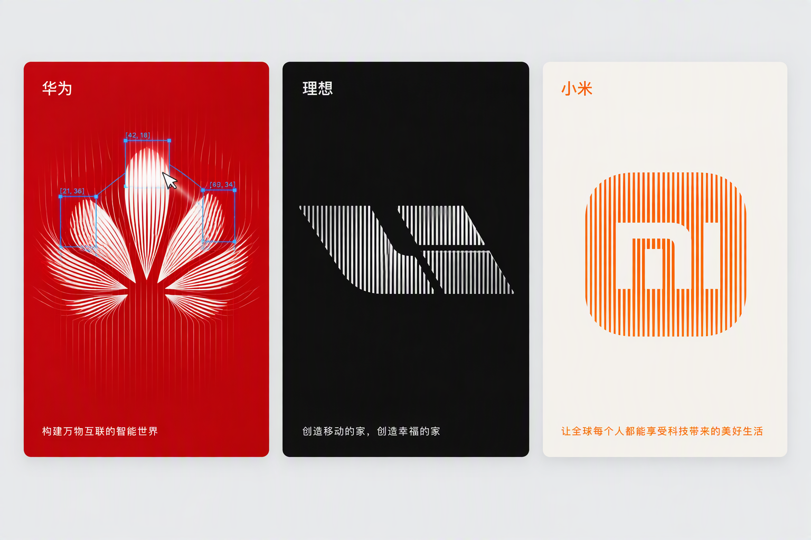

# line-logo-cards

把品牌 Logo 渲染成「竖线亮度表卡片」的 Agent skill 与 HTML 模板：不用任何图片，输出单个零依赖 HTML 文件。

<p align="center">
  
  
</p>
<p align="center"><sub>左：静止时线条随噪声缓慢浮动；右：鼠标悬停时线条散开，并出现蓝色检测框。</sub></p>

## 原理

1. **离屏绘制**：把 Logo 的 SVG path 画到一块离屏 canvas 上。
2. **采样亮度表**：按 `CELL` 大小切格，逐格采样平均亮度，存成二维亮度表。
3. **竖线查表**：屏幕上 `LINES` 根等距竖线逐帧查表，亮处用粗线、暗处用细线（共 4 档），Logo 形状由此浮现。
4. **噪声浮动**：叠加一层缓慢向下流动的噪声，让线条在待机时轻微起伏。
5. **悬停散开**：鼠标附近 `SCATTER_R` 半径内的线被推开，离开后弹性回位。
6. **检测框**：在最亮区域生成 AI 识别风格的蓝色检测框，框体吸附网格，带角标坐标，框与框之间有连线。

## 快速开始

直接双击打开 `assets/template.html` 即可看到效果，内置 华为 / 理想 / 小米 三个预设：

| 预设 | 配色 |
| --- | --- |
| 华为 | 红底、白线 |
| 理想 | 黑底、银白线 |
| 小米 | 米白底、橙线 |

换成其他品牌时，只需修改文件顶部的 `CONFIG` 数组。最小字段示例：

```js
const CONFIG = [
  {
    name: "MyBrand",
    bg: "#f2f2f2",           // 卡片背景色
    line: "#111111",         // 竖线颜色
    viewBox: "0 0 24 24",    // SVG path 的坐标系
    path: "M12 2L2 22h20L12 2z",  // Logo 的 SVG path
    slogan: "Your tagline here."   // 左下角标语
  }
];
```

## 作为 skill 使用

把 `SKILL.md` 连同 `assets/` 目录一起放进 agent 的 skills 目录，agent 即可识别并触发该 skill。触发说法示例：

- 「把这个 Logo 做成竖线亮度卡片」
- 「仿 Cloudflare 客户墙，给这几个品牌生成线条 Logo 卡片」
- 「用 line-logo-cards 生成一个小米的卡片」

输入清单、六步管线规格、完整参数表和验收清单见 `SKILL.md`。

## 参数速览

| 参数 | 默认值 | 说明 |
| --- | --- | --- |
| `CELL` | `6` | 亮度采样格子的边长（px） |
| `LINES` | `48` | 竖线根数 |
| `WIDTHS` | `[0.7, 1.5, 2.6, 4.2]` | 4 档线宽，从暗到亮 |
| `NOISE_AMP` | `0.26` | 待机噪声浮动幅度 |
| `SCATTER_R` | `80` | 鼠标悬停时的散开半径（px） |
| `BOX_MAX` | `3` | 同时显示的检测框上限 |

## 小红书图文模板（xhs-templates/）

把文章、案例或笔记转成小红书图文，每页 1080×1440。内置 11 种版式：封面、目录、观点、数字、对比、步骤、清单、金句、问答、图文、结尾，提供浅色、深色两套主题。模板是单个零依赖 HTML 文件，示例内容为本仓库的竖线 Logo 案例，共 8 页。

| 文件 | 说明 |
| --- | --- |
| `xhs-templates/SKILL.md` | skill 定义，名称为 `xhs-template-cards` |
| `xhs-templates/assets/template.html` | 渲染模板，单文件、零依赖 |

三条硬规则：

- 先出分镜表，确认后再出图。
- 每个版位的字数是固定的，超出时修改文案，不缩小字号。
- 一页只讲一个意思。

使用方式：在 `template.html` 顶部的 `DATA` 中填入文案，用浏览器打开即可渲染。

## 幻灯片母版（deck-masters/）

`deck-masters/` 是仓库新增的 HTML 幻灯片母版模块，适合把内容按统一版式快速整理成 16:9 幻灯片。它输出单个零依赖 HTML 文件，尺寸为 1920×1080，可直接演示，也可打印成 PDF。当前示例 deck 使用本仓库的竖线 Logo 案例，共 10 页，图表页基于三个品牌 Logo 路径字符数的真实数据。

| 文件 | 说明 |
| --- | --- |
| `deck-masters/SKILL.md` | skill 文档，skill 名为 `deck-masters` |
| `deck-masters/assets/template.html` | 幻灯片母版模板，生成单文件 HTML deck |

- 先出套版表确认内容结构，再按母版生成成稿。
- 内置 11 种版式：封面、目录、章节、观点、要点、对比、数据、图表、图文、团队、结尾。
- 设计系统采用锌灰中性色、分层底盘和卡片阴影；点缀色每页只用一处，章节页固定为深色背景。

使用方式：先用套版表定版，再基于 `assets/template.html` 套版生成 HTML 幻灯片。

## 来源与说明

- **灵感与致谢**：效果灵感来自 Cloudflare 官网的客户墙。X 作者 Ian（[@ianneo_ai](https://x.com/ianneo_ai)）对其做了拆解与复刻，本仓库在此基础上将其整理为可复用的 skill。
- **商标声明**：华为、理想、小米的 Logo 均为各自公司的注册商标。本仓库仅用于学习与演示，不代表与上述公司存在任何关联。
- **path 来源与验货**：预设 path 均逐字取自真实数据源——华为、小米取自 simple-icons（24×24），理想取自 Wikimedia Commons「Li Auto logo.svg」（49×20）；使用前须实际渲染检查，确认形状正确、无变形或缺失后再用。替换为其他品牌时同理。
